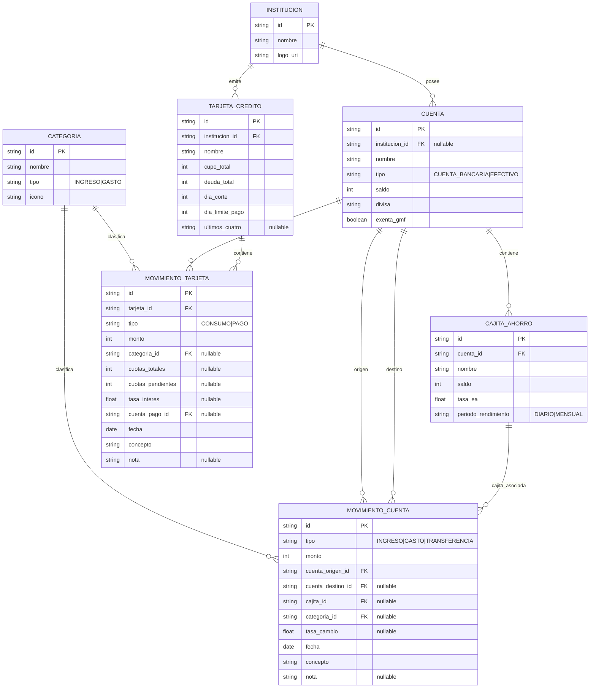

# Modelo Entidad-Relación — FinanceZ

## Diagrama Entidad-Relación (ERD)

## Reglas de Integridad y Lógica Financiera
- **Cuentas y GMF:** `EFECTIVO` carece de `institucion_id` y siempre es exento de GMF. `CUENTA_BANCARIA` requiere institución y si `exenta_gmf = false`, sus débitos generan el 4x1000 correspondiente.
- **Cajitas de Ahorro:** Entidades hijas dependientes de una `CUENTA` bancaria. El traspaso cuenta <-> cajita y abonos de rendimiento usan `cajita_id` en `MOVIMIENTO_CUENTA`.
- **Categorías e Instituciones:** Soportan `icono` (SVG, imagen o emoji) y `logo_uri`.
- **Tarjetas:** Los consumos acumulan `deuda_total`; los pagos reducen deuda y debitan de `CUENTA` (`cuenta_pago_id`).