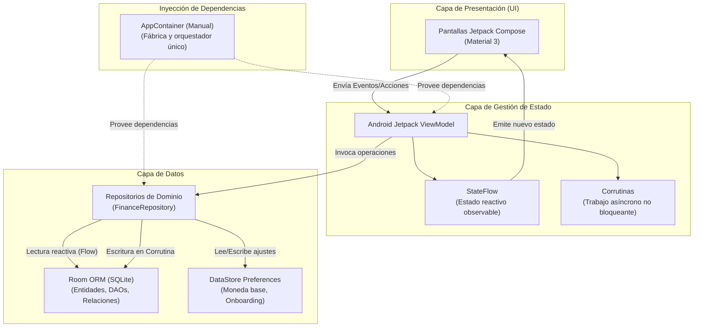

# Stack Tecnológico y Arquitectura — FinanceZ

## 1. Diagrama de Arquitectura del Sistema

## 2. Componentes del Stack
- **Lenguaje & JDK:** Kotlin 2.0+ y JDK 23 (instalado v23.0.2). Concurrencia estructurada mediante corrutinas.
- **Interfaz (UI):** Jetpack Compose (Material 3). UI declarativa guiada por estado inmutable.
- **Estado (State):** `StateFlow` emite el estado actual a la pantalla; la UI no manipula datos directamente.
- **Concurrencia:** `Coroutines` ejecutan lecturas/escrituras en segundo plano sin congelar la fluidez visual.
- **Reactividad:** `Flow` conecta Room con la UI para actualizaciones automáticas en tiempo real.
- **Persistencia:** Room ORM para la base de datos relacional y DataStore para preferencias simples.
- **Inyección:** Inyección manual mediante `AppContainer` (cero cajas negras, trazabilidad total).

## 3. Matriz de Justificación
| Capa | Herramienta | Justificación |
| :--- | :--- | :--- |
| **Lenguaje** | Kotlin 2.0+ / JDK 23 | Estándar de la industria, seguro y concurrente. |
| **UI** | Jetpack Compose | Declarativo, reactivo y control de la paleta neobanco. |
| **Estado** | ViewModel + StateFlow | Supervivencia al ciclo de vida y estado predecible. |
| **Asincronía** | Coroutines & Flow | Operaciones fluidas sin congelar el hilo principal. |
| **Persistencia** | Room ORM | Base de datos local robusta con validación en compilación. |
| **DI** | Inyección Manual | Comprensión línea por línea sin librerías invasivas. |